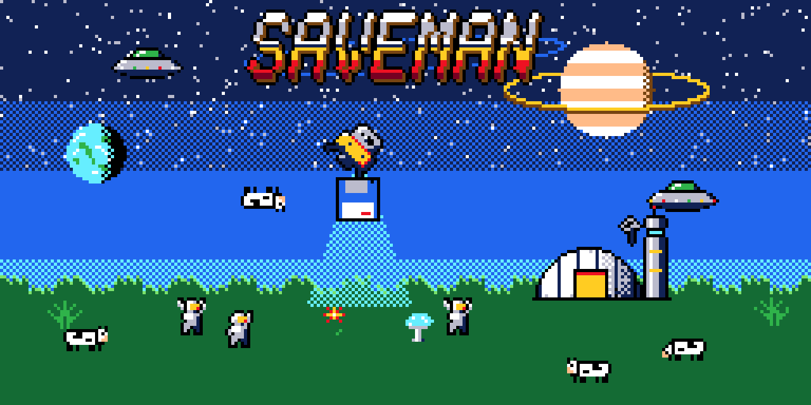
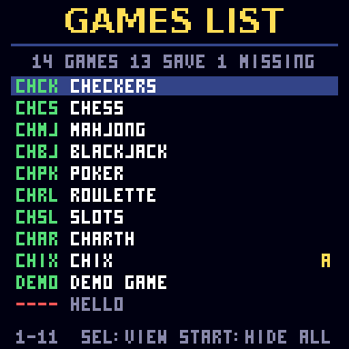
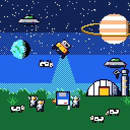
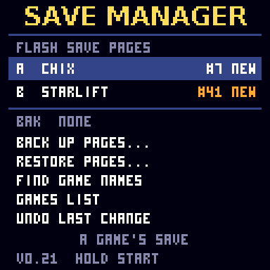
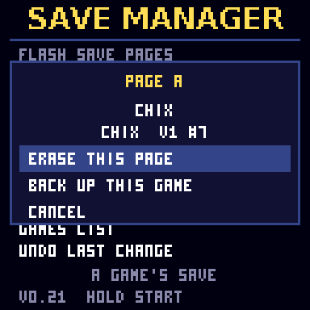
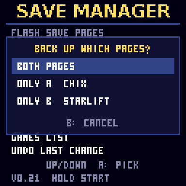
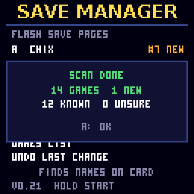
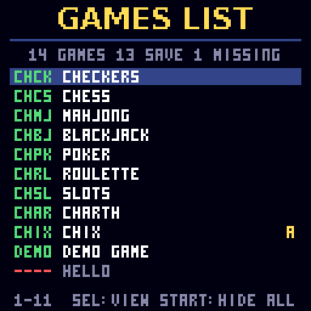
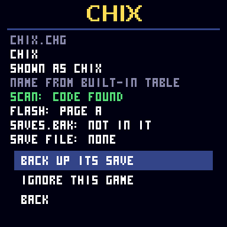

# CHSaveMan: a save manager for CHGame

Every CHGame game keeps its save in two shared flash pages (0xF500 and 0xF600). CHSaveMan shows what is in them
and which game owns each save. It backs them up to the SD card, restores them and erases a page.

 

## Install

1. Copy `SAVEMAN.CHG` (from the release, or `dist/`) to the `GAMES` folder of the SD card (FAT16 or FAT32).
2. Pick SAVE MANAGER in the menu. Hold START for 3 s to leave.

**Back up first.** SaveMan writes the flash pages every game shares. Each restore and erase first saves the
current pages to `SAVES.UND` (UNDO LAST CHANGE puts them back), and every page write is read back. No warranty
(GPL-3.0, sections 15-16).

## Features

- **Main screen:** both pages with the game, the save's age (`#counter`) and BAK (backed up) or NEW (not yet).
  If a page holds a newer save than the backup, it offers BACK UP NOW?
- **Back up** to `SAVES.BAK` (the old one is kept as `SAVES.BK1`), for both pages, one page, or one game's save
  (`SAVES/<CODE>.SAV`).
- **Restore** from any backup file. It shows what each page holds now and what it would hold, with LOSES warnings.
- **Undo** the last restore or erase, and undo the undo.
- **Erase a page**, with a warning when it holds the only copy of a game's save.
- **FIND GAME NAMES** scans the card's `.CHG` files (`GAMES` and two levels below) so saves show real titles.
  78 games take about 12 s.
- **GAMES LIST:** every game in ALL / MISSING ONLY / SAVES ONLY / IGNORED ONLY views. Hide games you don't care
  about (one at a time, or HIDE ALL without a save), show them again, or write `GAMELIST.CSV`.
- **Game details:** path, title, scan result, flash page, backup status; back up or restore just that save.
- A game over 50,432 bytes reaches into page A; SaveMan shows UNKNOWN DATA there. It is harmless, and backup and
  restore copy it as is.
- If a flash write fails, the library turns saving off until restart (SAVING IS OFF).

| | | |
|---|---|---|
|  |  |  |
|  |  |  |

## Controls

UP / DOWN choose, A picks, B goes back. Hold START for 3 s for the menu. In GAMES LIST: LEFT / RIGHT page, SELECT
changes view, a short START hides all, shows all or writes the CSV (by view), A opens a game.

## Files on the card

| File | Content |
|---|---|
| `SAVES.BAK`, `.BK1`, `.UND`, `.UN2` | 528 bytes: `CHSVBK01`, CRC-32, page count, then pages A and B. BK1 = the backup before; UND = before the last restore or erase; UN2 = before the last undo. To use a BK1, rename it to `SAVES.BAK`. |
| `SAVES/<CODE>.SAV` | One game's page (272 bytes); the previous one is `.SV1`. |
| `GAMELIST.TXT` | Rewritten by each scan: `PATH CODE TITLE`. |
| `IGNORE.TXT` | Hidden games, one path or file name per line; `#` comments. Only the first 1 KB is used. |
| `SAVENAME.TXT` | `CODE=NAME` lines. They win over the built-in table; the app only appends. |
| `GAMELIST.CSV` | `file,folder,code,title,reason missing`, written from SAVES ONLY. |

A power cut can leave `.TMP` files; they are read in place of the missing file and renamed by the next write.
FAT12, exFAT and NTFS cards show CARD NOT FAT32. Format large cards as FAT32.

## Status

v0.21 changes only a footer text since v0.20, which was board-tested with 78 games: a save round trip (back up, erase, restore, the game loads it), the NO CARD and
CARD ERROR screens, HIDE ALL / SHOW ALL, and a scan with every frame under 33.3 ms (30 fps). Not yet tried: an
empty slot (NO CARD) and an exFAT card on the board. Image 50,428 B of 50,432, RAM about 16.9 KB.

## Build and test

Needs the Arduino CLI with the CHGame board package (`CHGame:ch32v`), Python 3 (pyserial, Pillow) and, on Windows,
Git Bash and a gcc such as w64devkit.

    ./cl build     flash and RAM
    ./cl test      host test of the card code and FatFs on a RAM disk
    ./cl check     everything: host test, scripts, simulator tests, build

The simulator's card is a host file (`savm_sim.bak`, or `$SAVM_BAK`) and a folder (`$SAVM_CARD`); `$SAVM_NOCARD`
and `$SAVM_FAIL` fake card faults (`src/sd/sdio_sim.cpp`). `chgame/` is the vendored CHGame library with the raw
page calls added to `Save.h`/`Save.cpp` (see `chgame/PATCHES.md`).

## Licence and credits

GPL-3.0-or-later (LICENSE). The SD driver and FatFs glue come from CHSDtoSerial in CHGame (Kevin Bates, bateske),
derived from William Greiman's sdfatlib; `CHSaveMan/NOTICE` lists the changes. FatFs is by ChaN. Built on CHGame,
Copyright 2026 Kevin Bates, Apache-2.0. The title font is CHGfx's SansBold12 (DejaVu Sans Bold). Artwork in `docs/`
is made by `tools/make_media.py` from STARLIFT's sprites.
